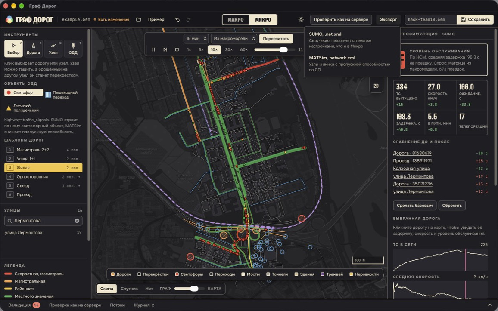

# Редактор графа УДС

Редактор графа улично-дорожной сети в формате OpenStreetMap для хакатона «Транспортное планирование городов» (Иркутск, 2026).

Редактор открывает `.osm`, показывает дорожную сеть в 2D на подложке (схема или спутник), позволяет визуально её править и сохраняет результат обратно в `.osm`. Сохранённый файл можно отправить на проверку в MatSim, SUMO и Webots.

## Как выглядит

| Потоки (макро) | Микро: LOS и светофоры |
|---|---|
|  |  |
| **Сравнение до и после** | **Экспорт** |
|  |  |

Цвет дорог в макро показывает загрузку V/C, розовые метки обозначают центры зон. В микро цвет дороги показывает уровень обслуживания по задержке, а точки на перекрёстках показывают текущую фазу светофора. Сравнение снято после того, как на улице Игошина сделали 4 полосы вместо 2: средняя задержка упала на 40 с.

## Запуск

Готовые сборки под macOS (`.dmg`) и Windows (`.msi`, `.exe`) собирает GitHub Actions, их можно скачать во вкладке Actions из последнего прогона `build`.

Приложение из исходников (нужны Node 22 и Rust):

```bash
npm install
npm run app          # окно приложения с горячей перезагрузкой
npm run app:build    # .app и .dmg в src-tauri/target/release/bundle/
```

Без Tauri редактор работает и в браузере, только без проверки на SUMO, MATSim и Webots:

```bash
npm run dev          # http://localhost:5173
```

Тесты: `npm test` для интерфейса и модели OSM, `cargo test` в `src-tauri/` для Rust.

## Проверка как на сервере

Кнопка «Проверить как на сервере» (вкладка «Чек-лист сдачи» внизу) прогоняет текущий граф через те же адаптеры, что и сервер организаторов, и показывает отчёт по каждому уровню:

- **SUMO.** `netconvert` с опциями OSM WebWizard (`--geometry.remove --ramps.guess --junctions.join --tls.guess-signals --tls.discard-simple --tls.join --tls.default-type actuated`), затем `randomTrips.py` и 20 минут модели в `sumo`. В отчёте рёбра, перекрёстки, светофоры, тупики, поездки без маршрута, телепортации, столкновения, средняя скорость.
- **MATSim.** `OsmNetworkReader` строит сеть, `NetworkCleaner` показывает, какие линки выпадают из сильно связной части. По ним агенты не поедут.
- **Webots.** Штатный `osm_importer/importer.py` собирает мир, в отчёте число дорог, перекрёстков и зданий и ошибки импорта.

Так ошибки видны до отправки файла на сервер. Кнопка «Сравнить с исходным файлом» прогоняет и файл в том виде, в каком его открыли, и ставит рядом «было» и «стало» по каждому показателю. Проверка ищет инструменты в стандартных местах, любое из них можно переопределить переменной окружения:

| Инструмент | Где ищем | Переменная |
|---|---|---|
| SUMO 1.28 | `~/tools/sumo-venv/bin` (на Windows `Scripts`), `%SUMO_HOME%\bin`, затем `PATH` | `GRAF_SUMO_BIN`, `SUMO_HOME` |
| MATSim 2026.0 | `~/tools/matsim/matsim-2026.0` | `GRAF_MATSIM_DIR` |
| Java 25+ | `/opt/homebrew/opt/openjdk/bin/java`, затем `PATH` | `GRAF_JAVA` |
| Импортёр Webots R2025a | `/Applications/Webots.app/...` или `C:\Program Files\Webots\...` | `GRAF_WEBOTS_IMPORTER` |
| Python для импортёра | `~/tools/webots-venv/bin/python`, затем `python3` | `GRAF_WEBOTS_PYTHON` |

Как поставить окружение на маке:

```bash
python3 -m venv ~/tools/sumo-venv && ~/tools/sumo-venv/bin/pip install eclipse-sumo==1.28.0
python3 -m venv ~/tools/webots-venv && ~/tools/webots-venv/bin/pip install pyproj shapely webcolors numpy
brew install openjdk   # MATSim 2026.0 требует Java 25 или новее
```

На Windows то же самое в PowerShell:

```powershell
py -m venv $HOME\tools\sumo-venv
& $HOME\tools\sumo-venv\Scripts\pip install eclipse-sumo==1.28.0
```

Если SUMO стоит из официального установщика, он сам задаёт `SUMO_HOME`, и приложение возьмёт программы из `%SUMO_HOME%\bin`. Для `randomTrips.py` тогда нужен Python в `PATH`. Без SUMO панель «Микро» покажет, чего не хватает, и эти же команды.

MATSim 2026.0 берётся архивом с [matsim.org](https://matsim.org/downloads) и распаковывается в `~/tools/matsim/`. Webots R2025a ставится с [cyberbotics.com](https://cyberbotics.com/).

## Как устроено сохранение

Файл читается **без потерь**. В памяти хранится весь документ OSM: узлы, линии, отношения, все теги и атрибуты (`version`, `timestamp`, `user`…), а также `<bounds>`. Граф дорог строится из этих данных только для отображения и проверок.

При сохранении:
- неизменённые объекты записываются как были, с теми же id и атрибутами; здания, трамвайные пути, остановки и переходы остаются в файле (Webots использует их для 3D);
- правки записываются **стандартными тегами OSM**, которые понимают штатные адаптеры: `oneway`, `lanes`, `lanes:forward`/`lanes:backward`, `turn:lanes`, `maxspeed`, `bridge`/`tunnel` + `layer`, `highway=traffic_signals`, `surface`;
- новые объекты получают положительные id больше всех существующих, поэтому их принимает любой импортёр;
- из отношений (маршрутов ОТ) удаляются только объекты, удалённые в редакторе. Ссылки на объекты за пределами фрагмента сохраняются.

Без правок `example.osm` → редактор → `.osm` даёт идентичный набор данных (это проверяется тестом).

## Интерфейс: что где и какая кнопка что делает

Окно делится на пять частей: шапка сверху, навигатор слева, карта в центре, инспектор справа, нижняя панель. Края панелей тянутся мышью, панели сворачиваются, размеры запоминаются (`src/state/panels.ts`). Кнопка «?» в шапке (или клавиша `?`) открывает справку: шаги, инструменты и все горячие клавиши (`src/components/HelpDialog.tsx`).

### Шаги работы

Работа идёт по трём шагам в центре шапки (`src/components/StepBar.tsx`, `src/state/steps.ts`): **Редактирование**, **Макро**, **Микро**. Проверка и сдача — не шаги: их вкладки внизу есть всегда (Ошибки графа, Журнал ошибок, Отчёт сервера, Чек-лист сдачи, Что изменено). Шаг добавляет к ним свои:

| Шаг | Что делать | Свои вкладки внизу |
|---|---|---|
| Редактирование | Рисовать и править дороги, перекрёстки, знаки, здания | — |
| Макро | Зоны, матрица поездок, загрузка дорог в час пик | Потоки, Транспорт, Сценарии |
| Микро | SUMO: машины по полосам, светофоры, задержки; справа панель Микро | Сценарии |

### Шапка (`src/components/Header.tsx`)

| Элемент | Что делает |
|---|---|
| Открыть (⌘O) | Открыть `.osm` с диска (`src/state/actions.ts` → `openFile`). |
| Пример | Открыть фрагмент из задания (`loadExample`). |
| Из OSM | Скачать любой район или город через Overpass (`src/components/AreaMenu.tsx`, `src/state/area.ts`, `src/osm/overpass.ts`). |
| Отменить / Повторить (⌘Z, ⌘⇧Z) | История правок, каждая правка один шаг, перетаскивание узла тоже один шаг. |
| Шаги 1–5 | См. выше. |
| Имя файла и «Сохранено» / «Не сохранено» | Какой файл открыт и есть ли несохранённые правки. |
| ? | Справка. |
| Тема | Светлая или тёмная, по умолчанию как в системе. |
| Сохранить (⌘S, ⌘⇧S) | Записать `.osm`. Имя файла для сервера, проверка как на сервере и экспорт — во вкладке «Чек-лист сдачи». |

### Навигатор слева (`src/components/Navigator.tsx`)

Три вкладки:
- **Объекты.** Поиск по названию и списки:
  - улицы, клик выделяет всю улицу;
  - перекрёстки;
  - ТСОДД: светофоры, переходы, знаки.
  - Кнопка «Показать первый на карте» перелетает к объекту.
- **Вид карты** (`src/components/ViewSettings.tsx`). Все настройки вида в одном месте:
  - «Режим вида» (`src/map/lens.ts`, `src/map/editScope.ts`): Все объекты, Авто · общий вид, Авто · знаки и светофоры, Пешеходы, Общественный транспорт, Железная дорога, Метро, Загрузка. Режим приглушает чужое и **ограничивает правку**: в нём выбираются, подсвечиваются и правятся только свои объекты, лишние инструменты гаснут. В «Авто · общий вид» знаки, светофоры, переходы, рельсы и тротуары не выделяются и не правятся; в «Знаках и светофорах» наоборот. «Загрузка» — только смотреть;
  - «Подложка»: Схема OSM, Спутник или нет, и ползунок «граф — карта»;
  - слои по группам: Улично-дорожная сеть, ТСОДД, Транспорт, Окружение и анализ.
- **Легенда.** Что значит каждый цвет и значок на карте.

### Карта (`src/components/MapOverlay.tsx`)

- **Инструменты** слева сверху, каждый с подписью и клавишей (`src/components/tools.ts`):

| Кнопка | Клавиша | Что делает |
|---|---|---|
| Просмотр | H | Только смотреть: клик показывает объект в инспекторе, но ничего нельзя сдвинуть, удалить или поменять, поля инспектора только для чтения. |
| Выбор | V | Клик выбирает **участок дороги между двумя ближайшими перекрёстками**, узел или здание. Узел можно тащить. Брошенный на другой узел, он делает перекрёсток. Рамка с зажатым Shift выбирает несколько дорог. |
| Дорога | D | Рисование новой дороги, подробно в разделе «Рисование дороги». Рядом появляется полоса: Прямая или Кривая, длина и угол отрезка, «Готово». |
| Узел | N | Клик по дороге добавляет точку: для изгиба или будущего перекрёстка. |
| Здание | B | Ставит здание по шаблону (1–3), оно само встаёт вдоль ближней дороги. R поворачивает на 90°, Shift+R на 15°. |
| ОДД | T | Знаки ПДД и объекты ОДД из капсулы внизу (вкладка «Знаки и ОДД»): светофоры, приоритет 2.1–2.5, запрещающие 3.1–3.28 (3.24 со своим числом), предписывающие 4.1.x, 5.5, 5.16, 5.19, 5.20, 5.21, табличка 8.13. Знак прилипает к ближней дороге и встаёт у её края, со стороны курсора: для того направления он и действует. Клик ставит узел на дороге с `traffic_sign=RU:<код>` и `direction`, где есть свой тег — и его (`highway=give_way|stop|crossing|traffic_signals`, `traffic_calming=bump`). Светофор встаёт на перекрёсток под курсором. Узел знака тянется только вдоль дороги, в инспекторе знак меняется, разворачивается на встречное направление и снимается. «Расставить знаки по ПДД» — в той же вкладке. |

- **Капсула заготовок** внизу по центру (`PresetDock.tsx`): круглые кнопки раскрывают вверх ленту карточек; карточка включает инструмент с этой заготовкой, капсула сворачивается и показывает выбранное. Заготовки отобраны под режим вида (`PRESETS` в `editScope.ts`): в «Пешеходах» только тротуары, дорожки, лестницы, переход и вход в метро; в «Авто» только дороги для машин; в «ОТ» трамвайные пути и остановки; в «Метро» пути и станции метро.
- **Тротуары.** Блок «Тротуары» в инспекторе дороги: обе стороны, слева, справа или нет, ширина и покрытие (`sidewalk`, `sidewalk:<сторона>:width|surface`, `src/osm/sidewalks.ts`); правка выбранного участка отрезает его от линии. В режиме «Пешеходы» клик по дороге показывает только этот блок. Отдельный тротуар или дорожка рисуется инструментом «Дорога» (заготовки «Тротуар», «Дорожка», «Лестница»).
- **Метро** рисуется отдельно: путь `railway=subway` — линией цвета `colour` (без него красной), в тоннеле пунктиром; станция метро (`station=subway`) — красный круг «М», вход — `railway=subway_entrance`. Подземным линиям и дорожкам здания не мешают.
- **«Вид карты»** вверху по центру (`ViewNote.tsx`) — «островок»: плашка с текущим режимом по клику плавно раскрывается в список режимов с подсказками и подложкой, клик мимо или Esc сворачивает. Дороги всегда рисуются инженерно: полосы, разметка, стрелки.
- **Подсказка** внизу по центру (`MapHint.tsx`). Одна строка о том, что можно сделать сейчас с этим инструментом и этим выбором. Она скрывается ✕ и включается снова в справке.
- **Справа**: масштаб, весь граф, на север, 2D / 3D (P).
- В шаге «Микро» место инструментов занимает полоса SUMO: длительность, спрос, пешеходы, «Запустить SUMO», проигрывание.

На карте всегда видно:
- выделенный участок, он подсвечен оранжевой полосой с обводкой;
- дороги с ошибками проверки, у них красное свечение под дорогой;
- стрелки направления движения на каждой дороге;
- стрелки поворотов на полосах перед перекрёстком.

### Инспектор справа (`src/components/Inspector.tsx`)

Показывает свойства выбранного. Содержимое зависит от того, что выбрано:

- **Ничего не выбрано**: экран «С чего начать» с кнопками «Нарисовать дорогу», «Светофор или знак», «Поставить здание», «Узел на дороге». Если в графе есть ошибки, там же кнопка «Исправить ошибки графа», она ведёт к шагу 2.
- **Дорога** (`WayInspector.tsx`). Заголовок «участок между точками», рядом ссылка «Править всю линию». Правка участка сначала отрезает его от линии, поэтому соседние участки не меняются. Блоки:
  - «Свойства»: класс, название, главная дорога (`priority_road`);
  - «Полосы и направление»: всего, туда и обратно, полоса для автобусов и такси с буквой «А», лента полос (клик по полосе открывает редактор одной полосы);
  - «Профиль по СП» с кнопкой «Привести к норме»;
  - «Ограничения»;
  - «Высота»: мост, тоннель, уровень;
  - «Как прочитают симуляторы»;
  - «Все теги OSM».
- **Редактор одной полосы** (`LaneEditor.tsx`). Разрешённые манёвры (налево, прямо, направо, разворот), полоса для маршрутных ТС и такси, ширина полосы, ограничение скорости на полосе. Пишет стандартные теги `turn:lanes`, `psv:lanes`, `width:lanes` и `maxspeed:lanes`.
- **Узел** (`NodeInspector.tsx`). Блоки:
  - «Дороги через узел», у каждой кнопка **«Отсоединить»**: дорога получает свою точку в 2 м, и её можно увести;
  - «Организация движения»;
  - маршрут «Отсюда / Сюда»;
  - у перекрёстка: кнопка «Редактор перекрёстка», «Полосы» (полосы въездов − / +, направления каждой полосы, шаблоны), «Знаки приоритета» (без знака, главная дорога, уступи дорогу, STOP на каждом въезде), «Пропускная способность», «Сведения»;
  - «Все теги OSM».
- **Улица целиком** (`StreetInspector.tsx`), **несколько дорог** (`MultiInspector.tsx`), **здание** (`BuildingInspector.tsx`), **ж/д путь и станция** (`RailInspector.tsx`).
- В режимах «Дорога» и «ОДД» инспектор показывает каталог шаблонов дорог с поперечным профилем и палитру знаков (`ToolCatalog.tsx`).

### Редактор перекрёстка (`src/components/JunctionEditor.tsx`)

Открывается двойным кликом по перекрёстку на карте или кнопкой в инспекторе, Esc закрывает. Слева крупная схема только этого перекрёстка и примыкающих дорог (около 40 м): полосы, разметка, стрелки, стоп-линии, связи полос, знаки на въездах и светофор. На схеме:
- от красной точки въезда к синей точке выезда тянется новая связь;
- клик по ленте выбирает манёвр, Delete запрещает его;
- клик по знаку меняет его: без знака → главная дорога → уступи дорогу → STOP.

Справа вкладки **Полосы**, **Знаки**, **Светофор**, **Пропускная**, **Сведения**: те же блоки, что в инспекторе (`JunctionParts.tsx`).

- **Знаки** по каждому въезду: приоритет (2.1, 2.4, 2.5), ограничение скорости 3.24 (`maxspeed`), пешеходный переход 5.19 (узел `highway=crossing`), запреты поворотов 3.18.1, 3.18.2, 3.19 (отношения `type=restriction`), знаки по полосам 5.15.1 (из `turn:lanes`). Если главная дорога поворачивает, подсказка про табличку 8.13. У уступающих въездов — критический интервал и интервал следования и пропускная способность полосы по формуле Хардерса. На схеме у въезда стоит стопка знаков.
- **Светофор** (`SignalPlanSection.tsx`, `src/osm/signalPhases.ts`): поставить и убрать, фиксированный или адаптивный режим, свои фазы. Цикл нарисован шкалой: сверху фазы, ниже у каждого въезда полоса из зелёного, стрелки, жёлтого и красного; граница зелёного тянется мышью. У фазы зелёный, жёлтый, общий красный и как едет каждый въезд (все направления, прямо и направо, стрелка налево, стоят), фаза может быть только пешеходной. Параметры: сдвиг цикла, поток насыщения, потерянное время, скорость пешехода, мин./макс. зелёный и разрыв для адаптивного. Расчёт пропускной способности въездов и цикл по Вебстеру по потокам Макро. В SUMO уходит tlLogic ровно из этих фаз (`netinfo.py`). Программа хранится рядом с файлом. Ленты связей и контур перекрёстка на карте видны только у выбранного перекрёстка.

### Нижняя панель (`src/components/BottomDock.tsx`)

Показывает вкладки текущего шага (таблица в «Шаги работы»). Клик по открытой вкладке сворачивает панель.

| Вкладка | Что там |
|---|---|
| Ошибки графа | Ошибки проверки с кнопками «Исправить», «Замкнуть кордон», «Проставить по ПДД всем» (`IssuesPanel.tsx`). |
| Журнал ошибок | Ошибки правок, проверки, симуляции и самой программы со временем. У ошибок графа отметка «исправлено» или «не исправлено». Журнал выгружается в `.txt` (`ErrorLogPanel.tsx`). |
| Что изменено | Что поменялось по сравнению с открытым файлом, выгрузка в Markdown (`Journal.tsx`). |
| Потоки | Макромодель: зоны, матрица, распределение, изохроны (`FlowsPanel.tsx`). |
| Транспорт | Маршруты ОТ и их интервалы (`TransitPanel.tsx`). |
| Сценарии | Версии графа с показателями и сравнение (`ScenariosPanel.tsx`). |
| Чек-лист сдачи | Четыре пункта с галочками: граф без ошибок, проверка как на сервере, имя файла `hack-teamNN.osm`, кнопки «Сохранить .osm», «SUMO .net.xml», «MATSim network.xml», «Отчёт HTML» (`SubmitPanel.tsx`, `exports.ts`). |
| Отчёт сервера | Отчёт MATSim, SUMO, Webots, рядом цифры исходного файла (`CheckPanel.tsx`). |

В шаге «Микро» справа вместо инспектора стоит панель Микро (`sim/MicroPanel.tsx`):
- показатели и графики;
- «Свои потоки»;
- тепловая карта задержек;
- узкие места.

## Возможности

**Открыть.** Загрузка `.osm` с диска или встроенный пример из задания (фрагмент от «Госуниверситета» до «Жуковского»).

**Любой район или город из OSM.** Кнопка «Из OSM» скачивает область напрямую через Overpass API: по названию города (поиск через Nominatim), по видимой области карты или из готовых вариантов (центр Иркутска, Иркутск целиком, Шелехов). Запрос берёт тот же набор объектов, что организаторы для `example.osm`: дороги, трамвай, светофоры, переходы, остановки, здания и маршруты ОТ, плюс все узлы этих линий, чтобы ничего не висело. Так редактор не привязан к одному фрагменту:
- фрагмент из задания, скачанный заново, даёт те же цифры на проверке: MATSim 163 линка и 140 после очистки, Webots 542 дороги и 365 зданий;
- Иркутск целиком (627 км²) в режиме «только дорожная сеть» — около 97 тыс. узлов и 20 тыс. линий, 24 МБ, скачивается примерно за минуту;
- для областей больше 40 км² здания отключаются сами: со зданиями файл города вышел бы в сотни мегабайт.

Если главный сервер Overpass перегружен, редактор пробует зеркала и повторяет запрос с паузой. В настольной версии запрос идёт через системный `curl`: публичные зеркала отклоняют запросы из браузера.

**Править.**
- Выбор дороги или узла, панель свойств: класс, название, направление, полосы (всего / туда / обратно), разметка поворотов `turn:lanes`, скорость, мост/тоннель и уровень, покрытие, а также таблица всех тегов OSM.
- Перетаскивание узлов мышью. Если бросить узел на другой, они объединятся в перекрёсток.
- Рисование новой дороги. Клик по существующей дороге создаёт общий узел (перекрёсток), шаблоны дорог переключаются клавишами 1–9.
- Вставка узла в дорогу, разрезание дорог в узле (чтобы атрибуты по разные стороны перекрёстка различались).
- Смена направления одностороннего движения, разворот линии с сохранением смысла (теги `:forward`/`:backward` меняются местами).
- Объекты ОДД на узле (клавиша T): светофор, нерегулируемый пешеходный переход, искусственная неровность.
- Профиль дороги по СП 42.13330.2016 и СП 34.13330.2021: категория, ширина полосы, расчётная скорость, пропускная способность. Кнопка «Привести к норме» дописывает ширину и ограничение скорости. Ограничения по массе, высоте, проезду грузовиков и автобусная полоса.
- **Улица целиком.** Клик по улице в списке (или ссылка «Вся улица» в инспекторе дороги) выделяет все её участки. Полосы, скорость, класс и покрытие меняются на всех участках одним шагом отмены, кнопка «Привести к норме» дописывает ширину и скорость по СП сразу всем. Панель показывает разброс пропускной способности вдоль улицы: на Объездной дороге из примера она скачет с 2400 до 4800 авт/ч, то есть на части участков потеряны полосы.
- **Здания для 3D.** Клик по зданию открывает его инспектор: этажность, высота, высота крыши, `min_height`, форма крыши (плоская, двускатная, вальмовая, шатровая), кровля, материал и цвет фасада. Это ровно те теги, из которых импортёр Webots строит 3D, и панель показывает, какую высоту Webots поставит зданию. Кнопки «Высота по этажам» и «Этажи по высоте» переводят одно в другое по правилу импортёра, 3 м на этаж. В примере из задания высота не указана ни у одного из 365 зданий.
- Отмена и повтор (Ctrl+Z / Ctrl+Shift+Z). Перетаскивание узла считается одним шагом.

**Проверить.** Проверка запускается вручную и автоматически перед сохранением:
- изолированные участки сети (не связаны с основным графом);
- тупики по направлению: узлы, из которых нельзя вернуться в основную сеть (анализ сильной связности, обычно это неверный `oneway`);
- дороги, пересекающиеся без общего узла на одном уровне (разорванный перекрёсток или пропущенный `bridge`/`layer`), с кнопкой «Исправить»: в точке пересечения вставляется общий узел;
- узлы дорог ближе 3 м друг к другу без соединения, с кнопкой «Исправить», которая объединяет их;
- дороги, обрезанные границей фрагмента. Это отдельная группа, а не ошибка карты: односторонняя проезжая часть, уходящая за край, выглядит для маршрутизатора тупиком, и MATSim выкидывает её из сети. Кнопка «Замкнуть кордон» соединяет две проезжие части разрезанной дороги разворотом за краем фрагмента, как это делают кордонные связи в транспортных моделях. На фрагменте из задания так в сеть MATSim возвращается Объездная дорога: отрезанных линков становится 4 вместо 23.

- ложные тоннели под мостами. Импортёр Webots не строит дороги с отрицательным `layer` («underground structure»), поэтому короткая дорога под путепроводом, отмеченная `tunnel=yes, layer=-1`, пропадает из 3D-сцены, и под мостом в дороге остаётся дыра. Проверка находит такие куски (тоннель короче 120 м, над которым проходит мост), кнопка «Исправить» оставляет дорогу на уровне земли. В примере из задания так пропадали Объездная и съезд под мостом Лермонтова.

- разная скорость в MATSim и SUMO. Без числового `maxspeed` каждый симулятор подставляет своё значение по умолчанию: районная улица едет 30 км/ч в MATSim и 100 км/ч в SUMO, `RU:urban` MATSim не читает вовсе. Кнопка «Проставить по ПДД всем» пишет скорость по п. 10.2 ПДД (60 км/ч в городе, 20 во дворах и жилых зонах), зона остаётся в `source:maxspeed`, и все уровни едут одинаково. Инспектор дороги показывает обе скорости;
- значения, на которых падает импортёр Webots: `lanes` не целое число от 1, нечисловой `layer` у любой линии, битый `#цвет` здания, `min_height` при крыше выше здания. На таком файле сервер не построит 3D-сцену и видео, а это условие допуска. Проверка находит их как ошибку, кнопка «Исправить» ставит безопасное значение, а поля инспектора не дают ввести такое число.

**Как прочитают симуляторы.** В инспекторе дороги таблица: скорость, полосы по направлениям и пропускная способность в MATSim, скорость и полосы в SUMO, высота в Webots. Правила сверены с сетями, которые программы организаторов строят из этого же файла: модель совпала со всеми 165 линками MATSim. Так одна правка прослеживается на все три уровня.

**Повороты (как Turns в PTV Visum).** В инспекторе перекрёстка перечислены все манёвры, которые разрешают направления движения: прямо, налево, направо, разворот, с названием улицы и стороной света. Снятая галочка запрещает манёвр стандартным отношением OSM `type=restriction` (`from`, `via`, `to`), его применяет SUMO netconvert при сборке сети. Сквозная дорога разрезается в узле, как требует OSM, `only_*` запреты при правке раскладываются в эквивалентные `no_*`. Перекрёстки с запретами обведены на карте.

**Маршрут (кратчайший путь).** В инспекторе узла кнопки «Отсюда» и «Сюда» строят самый быстрый путь по графу: длина, время без пробок, улицы. Если проехать нельзя, панель говорит, сколько узлов графа достижимо из начала: так видно, где сеть разрезают односторонние участки или разорванный перекрёсток.

**Изменения.** Вкладка «Что изменено» показывает, что поменялось по сравнению с открытым файлом: линии добавлены, удалены, изменены по геометрии или атрибутам, узлы, отношения. Слой «Изменения» раскрашивает их на карте, а список выгружается в Markdown с каждой правкой тега. Для нашего файла он лежит в [docs/changes.md](docs/changes.md).

**Потоки (макроуровень).** Шаг 3 «Макро», вкладка «Потоки» в нижней панели. Зоны задаются сеткой или вручную: клик по карте ставит центр зоны, перетаскивание двигает, правый клик удаляет. Вес зоны считается по площади зданий с учётом этажности, поэтому жилой квартал даёт больше поездок, чем пустырь. Матрица корреспонденций считается гравитационной моделью, ячейки можно поправить руками. Потоки распределяются по равновесию Вардропа методом Франка-Вульфа с функцией BPR. Толщина линии показывает поток, цвет показывает загрузку V/C. Матрица выгружается в CSV. Изохроны строятся от выбранного узла по времени свободного движения.

Поездки делятся на две цели: «дом–работа» тянется к нежилым зданиям и слабее зависит от времени, «дом–прочее» идёт ко всем зданиям. Параметр β гравитационной модели меняется ползунком, а кнопка «Подобрать β» находит его под заданное среднее время поездки: каждая проба считается с назначением на сеть, так что учитываются пробки. Рядом гистограмма времени поездок по минутам и таблица по целям.

**Микроуровень.** Шаг 4 «Микро» в шапке. Приложение собирает сеть SUMO из текущего графа (netconvert) и пускает смешанный поток: легковые, фургоны, грузовые, автопоезда, автобусы 12 и 18 м. Спрос бывает двух видов. «Случайный» берёт поездки из randomTrips. «Из макромодели» берёт матрицу из «Потоков»: каждая зона привязывается к ближайшему ребру сети SUMO, и поездки между зонами идут по матрице. Так оба уровня считают одни и те же поездки на одном графе.

Во время проигрывания машины окрашены по скорости, дороги по уровню обслуживания (HCM, A–F по средней задержке на ребре), сигналы светофоров меняют цвет по фазам SUMO. Клик по дороге показывает, сколько машин по ней проехало, скорость, задержку и стоянку. Прогон можно запомнить как базовый, поправить граф и пересчитать: панель покажет разницу показателей по сети и дороги, где задержка выросла или упала сильнее всего. Нужен установленный SUMO, работает только в настольной версии. Если SUMO не найден, панель скажет, чего не хватает, и покажет команды установки.

Что ещё есть в Микро:
- **пешеходы**: тротуары и переходы строит netconvert, люди ходят по randomTrips, у самых нагруженных переходов видно, сколько человек прошло;
- **общественный транспорт**: маршруты автобусов из OSM-отношений на вкладке «Транспорт», с интервалом движения; в SUMO они едут с остановками, панель показывает их скорость;
- **цикл светофора**: в инспекторе узла задаются длительность цикла и доля зелёного главного направления, это уходит в SUMO как `tlLogic`, а после прогона видно задержку на этом перекрёстке до и после;
- **тепловая карта задержек**: дороги с наибольшей потерей времени по минутам модели, клик по строке выбирает дорогу.

**Пучок потоков (как Flow bundle в Visum).** После распределения потоков выберите дорогу и нажмите «Кто едет по…»: панель покажет пары зон, чьи поездки идут по ней, а карта — их путь до и после этой дороги, толщина по числу поездок. Так видно, кого заденет правка дороги.

**Сценарии.** Вкладка «Сценарии» хранит версии графа с их показателями. Сохраните базу, сделайте правку отдельным сценарием и сравните пробег, время в пути, перегруженные дуги, задержку и скорость в одной таблице.

**Экспорт.** Шаг 5 «Сдача», вкладка «Чек-лист сдачи»: кнопки пишут сеть SUMO `.net.xml` (netconvert с теми же настройками, что в Микро) и сеть MATSim `network.xml` с пропускной способностью по СП. Там же «Отчёт, HTML»: один файл с показателями макро и микро, снимком карты, графиками, тепловой картой и таблицей сценариев. В браузере он печатается в PDF.

**Надёжность.** Несохранённые правки каждые 30 секунд пишутся в черновик. Если приложение закрылось аварийно, стартовый экран предложит их восстановить. Битый `.osm` открывается, если это возможно: узлы без координат и ссылки на отсутствующие узлы убираются, и приложение говорит, сколько убрано. Обрезанный или не-OSM файл даёт понятное сообщение. Граф на 60 тысяч сегментов (большой кусок Иркутска) остаётся отзывчивым: проверка идёт в фоновом потоке, длинные списки рисуют только видимые строки.

**Подсказки.** При первом открытии графа три подсказки ведут по пути «правка → потоки → микро». В каждой панели есть кнопка «Зачем» с коротким объяснением, для чего она.

**3D.** Кнопка 2D/3D или клавиша P наклоняет камеру и поднимает здания по `height` или `building:levels`. Мосты в 3D выглядят как настоящий путепровод: настил поднят на `layer × 5 м` (ровно на эту высоту их ставит импортёр Webots), подъезды показаны насыпью с плавным подъёмом на 70 м (уклон около 7%), под пролётом стоят опоры, а дорога и железная дорога под мостом остаются на земле. В 2D у мостов мягкая тень. Инспектор дороги пишет, на какой высоте Webots её построит.

**Подложка.** Схема OSM или спутниковый снимок Esri World Imagery для сверки с реальной УДС.

### Рисование дороги

Код рисования лежит в `src/osm/drawGeometry.ts`, `src/map/drawSnap.ts` и `src/osm/draw.ts`.

**Прилипание и углы.**
- **Магнит.** Курсор прилипает к узлу ближе 18 px и к дороге ближе 12 px. Клик по дороге ставит общий узел, то есть перекрёсток.
- **Сети не смешиваются.** Автодорога прилипает только к дорогам, трамвайный и ж/д путь только к путям. Машинная дорога не может соединиться с рельсами ни при рисовании, ни при перетаскивании узла (`mayJoin` в `src/osm/pieces.ts`).
- **Углы.** Направление тянется к шагу 15°, если отличается от него меньше чем на 4°. С зажатым Shift угол всегда идёт ровно по шагу 15°. Подсказка у курсора показывает длину и угол поворота.

**Форма дороги.**
- **Прямая или Кривая.** Переключатель формы дороги на панели. В режиме «Кривая» точки соединяются плавной дугой с шагом 6 м: так рисуются развороты и съезды под 45–60°.
- **Скругление углов.** Угол между отрезками скругляется радиусом по классу дороги. Тротуары на изгибе идут без разрыва.

**Дорога и здания.** Если новая дорога задевает здание, панель «Дорога задевает здание» предлагает три варианта: «Снести», «Срезать по дороге» или «Построить поверх» (`src/osm/clearance.ts`).

### Участок дороги, отсоединение

- Клик выбирает не всю линию OSM, а только участок между ближайшими перекрёстками. Его можно править или удалить отдельно, соседние участки не меняются (`src/osm/pieces.ts`: `pieceAround`, `isolatePiece`). Ссылка «Править всю линию» возвращает выбор всей линии.
- После объединения двух дорог в один узел каждую можно снова увести. Для этого в инспекторе узла есть кнопка «Отсоединить» у нужной дороги (`detachWay`).

### Полосы и общественный транспорт

- **Редактор одной полосы.** Клик по полосе на ленте в инспекторе дороги. Модуль `src/osm/laneTags.ts` пишет значение одной полосы в теги `*:lanes`, остальные полосы остаются как были.
- **Полоса для маршрутных ТС и такси** (знаки 5.11.1, 5.14 ПДД). Полоса пишется как `psv:lanes=…|designated`. На карте это терракотовая полоса с буквой «А», как разметка 1.23.1. SUMO читает её с ключом `--osm.lane-access` и пускает по ней только автобусы и такси (`src/osm/busLanes.ts`).
- **Остановки ОТ.** Ставятся инструментом ОДД, это `highway=bus_stop` и `public_transport=platform`. Автобусы в SUMO останавливаются на ближайшей к остановке полосе.

### Главные и второстепенные дороги, знаки по ПДД

- В инспекторе дороги есть флажок «Главная дорога» (`priority_road=designated`). На перекрёстке без светофора въезды с второстепенной дороги получают знак 2.4 «Уступите дорогу» или 2.5 «Стоп», главная получает знак 2.1.
- Кнопка «Расставить знаки по ПДД» в каталоге ОДД расставляет приоритетные знаки на всех нерегулируемых перекрёстках по классу дорог. Знак 5.19 у пешеходных переходов рисуется сам по `highway=crossing` (`src/osm/signs.ts`: `placeRuleSigns`). Знаки нарисованы по ГОСТ Р 52290 (`src/map/signArt.ts`).
- Вид дорог «Схема» показывает главные и районные дороги цветом, как на картах города.

### Проверка потоков по ПДД

Модуль `src/osm/flowRules.ts` проверяет потоки при каждой правке:
- **встречные потоки в лоб**: две односторонние дороги ведут друг в друга и упираются в узел;
- **неверный разворот**: съезд разворачивает машины на встречную проезжую часть.

У каждой проблемы есть кнопка «Исправить»: сменить направление или сделать дорогу односторонней.

### Дорога под зданиями

Проверка «проезжая часть заходит под здания» находит дороги, у которых явно заданы `lanes` или `width` и которые по реальной ширине заходят на дом больше чем на 10 м². Например, 8-полосная магистраль во дворе даст такую ошибку. Мосты, тоннели и проезды под домами (`tunnel=building_passage`) не считаются (`roadBuildingOverlaps` в `src/osm/clearance.ts`). На файле из задания проверка находит один такой участок Объездной.

### Пропускная способность перекрёстков

Модуль `src/osm/capacity.ts` считает пропускную способность каждого въезда по числу полос и роли въезда: главная, второстепенная или со светофором. После прогона SUMO рядом встаёт фактический поток. Узкие места собраны в список в Микро и на вкладке «Пропускная» редактора перекрёстка.

### Светофоры: секции и пешеходная фаза

В программе светофора (`SignalPlanSection.tsx`) задаются:
- цикл и доля зелёного;
- адаптивный режим.

Блок «Дополнительные секции» включает:
- **стрелку направо**: правый поворот едет в зелёную фазу поперечного направления;
- **стрелку налево**: защищённая левая фаза 12 с и 3 с жёлтого перед основной фазой;
- **пешеходную фазу**: все машины стоят, люди идут, длительность задаётся, после неё 2 с «всем красный».

Программу собирает `program()` в `src-tauri/src/py/netinfo.py`, в SUMO она уходит как `tlLogic`.

### Спрос в Микро: час пик и свои потоки

- **Час пик.** Втрое больше машин, транзит по главным улицам, на перекрёстках появляются очереди.
- **Свои потоки.** В панели Микро нажмите «Добавить поток», затем два клика по карте: откуда и куда. Число машин в час задаётся в списке. Поток показан на карте линией со стрелкой. SUMO ведёт каждый поток по самому быстрому пути, а потоки хранятся между запусками (`src/sim/customFlows.ts`).

### Журнал ошибок

Вкладка «Ошибки» внизу (`src/state/errorLog.ts`, `ErrorLogPanel.tsx`) пишет в журнал:
- новые ошибки графа после правки с отметкой, когда их исправили. Ошибки, которые пришли с открытым файлом, помечены отдельно;
- сбои проверки на сервере и симуляции;
- ошибки самой программы: `console.error`, необработанные исключения.

Журнал выгружается в `.txt`.

### Подсветка

- Выбранный участок, узел или здание подсвечены поверх дорог.
- Дороги с ошибками проверки светятся красным.
- На всех дорогах нарисованы стрелки направления движения.

### Настоящие знаки этого района

Мы искали открытые данные о реальных знаках фрагмента:
- в OSM у этого района нет ни одного знака (`traffic_sign`);
- Mapillary отдаёт распознанные знаки только по личному токену API;
- данные 2ГИС и Яндекса закрыты, их условия запрещают выгрузку.

Поэтому знаки расставляются по ПДД из классов дорог, а не копируются с карты.

## Горячие клавиши

Буквенные клавиши работают и в русской раскладке. Список задан в `HOTKEYS` (`src/state/useHotkeys.ts`).

| Клавиша | Действие |
|---|---|
| V / D / N / T / B | Выбор / Рисовать дорогу / Узел на дороге / Объект ОДД / Здание |
| Enter, двойной клик | Завершить дорогу |
| Esc | Отменить рисование / снять выделение |
| 1–9 | Шаблон новой дороги |
| R | Развернуть порядок узлов (смысл сохраняется) |
| B, затем 1–3, R, Shift+R | Здание: шаблон, поворот на 90° и на 15° |
| ⌘/Ctrl+D, ⌘/Ctrl+C, ⌘/Ctrl+V | Копия здания рядом / скопировать / вставить под курсором |
| Alt при перетаскивании угла | Без прилипания к прямому углу |
| F | Поменять направление одностороннего движения |
| S | Светофор в выбранном узле |
| X | Разрезать дороги в выбранном узле |
| P | Переключить 2D и 3D |
| Delete / Backspace | Удалить выбранное |
| ⌘/Ctrl+Z, ⌘/Ctrl+Shift+Z | Отменить / Повторить |
| ⌘/Ctrl+O | Открыть файл |
| ⌘/Ctrl+S, ⌘/Ctrl+Shift+S | Сохранить / Сохранить как |
| Shift при рисовании дороги | Угол строго с шагом 15° |
| Shift + рамка мышью | Выбрать несколько дорог |
| Правый клик по зоне (Потоки) | Удалить зону |
| ? | Справка: шаги, инструменты, горячие клавиши |

## Структура: какой файл за что отвечает

Для каждого исходного файла: за что он отвечает и что из него экспортируется (функции, компоненты, типы). Рядом с файлом `x.ts` лежит его тест `x.test.ts`. Тесты: `npm test` (vitest), `cargo test` в `src-tauri/`.

Как идут данные: файл читает `osm/parse.ts` в неизменяемый документ, и он лежит в `state/store.ts`. Каждая правка (`osm/edit.ts` и соседние модули) возвращает новый документ, это один шаг отмены. Карта (`components/MapView.tsx`, `map/layers.ts`) и проверка (`osm/validate.ts` в фоновом потоке) пересчитываются от документа. Сохранение пишет его через `osm/serialize.ts`. SUMO и проверка сервера вызываются из Rust (`src-tauri/src`).

### Корень `src/`

| Файл | За что отвечает | Что внутри |
|---|---|---|
| [App.tsx](src/App.tsx) | Корень приложения: раскладка окна, тема, автосохранение, подписка журнала ошибок | `App` |
| [check.ts](src/check.ts) | Типы отчёта «Проверки как на сервере» (зеркало Rust `check::Report`) | `StageStatus`, `CheckStage`, `CheckReport` |
| [checkCompare.ts](src/checkCompare.ts) | Сравнение показателей проверки с исходным файлом, колонки «до/после» | `MetricRow`, `compareStage` |
| [main.tsx](src/main.tsx) | Точка входа React |  |
| [platform.ts](src/platform.ts) | Файлы, диалоги и вызовы Tauri; в браузере те же функции через Web API | `isDesktop`, `askUser`, `OpenedFile`, `openOsmFile`, `saveOsmFile`, `saveTextFile`, `exportSumoNet`, `downloadText`, `runServerCheck`, `mapDataFetch` |

### `src/components/sim/` — панели Микро

| Файл | За что отвечает | Что внутри |
|---|---|---|
| [CustomFlowsSection.tsx](src/components/sim/CustomFlowsSection.tsx) | Блок «Свои потоки» в Микро | `CustomFlowsSection` |
| [DelayHeatmap.tsx](src/components/sim/DelayHeatmap.tsx) | Тепловая карта задержек время × дорога | `DelayHeatmap` |
| [MicroPanel.tsx](src/components/sim/MicroPanel.tsx) | Панель Микро: показатели, графики, сравнение с базой | `wayLabel`, `MicroPanel` |
| [SimBar.tsx](src/components/sim/SimBar.tsx) | Полоса симуляции: пуск, шаг, скорость, спрос, пешеходы | `SimBar` |
| [SumoMissing.tsx](src/components/sim/SumoMissing.tsx) | Сообщение и команды установки, если SUMO не найден | `SumoMissing` |

### `src/components/` — интерфейс

| Файл | За что отвечает | Что внутри |
|---|---|---|
| [AreaMenu.tsx](src/components/AreaMenu.tsx) | Меню «Из OSM»: город, видимая область, готовые районы | `AreaMenu` |
| [BottomDock.tsx](src/components/BottomDock.tsx) | Нижняя панель: вкладки текущего шага | `TAB_LABELS`, `BottomDock` |
| [BuildingInspector.tsx](src/components/BuildingInspector.tsx) | Инспектор здания: размеры, поворот, форма, высота | `BuildingInspector` |
| [BundleSection.tsx](src/components/BundleSection.tsx) | Кнопка «Кто едет по…» и список пар зон пучка | `BundleSection` |
| [BusParts.tsx](src/components/BusParts.tsx) | Поля полосы для маршрутных ТС и блок остановки | `BusLaneFields`, `StopSection` |
| [CapacityParts.tsx](src/components/CapacityParts.tsx) | Пропускная способность перекрёстка и список узких мест | `JunctionCapacitySection`, `Bottlenecks` |
| [ChangesSummary.tsx](src/components/ChangesSummary.tsx) | Короткая сводка изменений против открытого файла | `ChangesSummary` |
| [CheckPanel.tsx](src/components/CheckPanel.tsx) | Кнопка и отчёт «Проверка как на сервере» | `useCheck`, `CheckButton`, `CheckPanel` |
| [EmptyState.tsx](src/components/EmptyState.tsx) | Стартовый экран без открытого файла | `Ribbon`, `Petals`, `EmptyState` |
| [ErrorLogPanel.tsx](src/components/ErrorLogPanel.tsx) | Вкладка «Ошибки»: журнал ошибок, выгрузка, очистка | `ErrorLogPanel` |
| [FlowsPanel.tsx](src/components/FlowsPanel.tsx) | Вкладка «Потоки»: зоны, матрица, β, распределение, изохроны | `FlowsPanel` |
| [Header.tsx](src/components/Header.tsx) | Шапка: открыть, пример, из OSM, отмена, шаги, справка, тема, сохранение | `Header` |
| [HeightFields.tsx](src/components/HeightFields.tsx) | Поля высоты здания и уровня дороги (мост, тоннель, layer) | `applyTags`, `BuildingHeightFields`, `RoadLevelFields` |
| [HeightHandle.tsx](src/components/HeightHandle.tsx) | Ручка высоты здания в 3D | `HeightHandle` |
| [HelpDialog.tsx](src/components/HelpDialog.tsx) | Справка «?»: шаги, инструменты, горячие клавиши, включение подсказок | `HelpDialog` |
| [Inspector.tsx](src/components/Inspector.tsx) | Правая панель: нужный инспектор, каталог инструмента или «С чего начать» | `Inspector` |
| [IssuesPanel.tsx](src/components/IssuesPanel.tsx) | Вкладка «Валидация»: группы ошибок, «Исправить», «Замкнуть кордон», «Проставить по ПДД всем» | `IssuesPanel` |
| [Journal.tsx](src/components/Journal.tsx) | Вкладка «Журнал»: изменения и выгрузка в Markdown | `Journal` |
| [JunctionParts.tsx](src/components/JunctionParts.tsx) | Части перекрёстка для инспектора и редактора: полосы, знаки, светофор, сведения | `JunctionLanes`, `JunctionSigns` |
| [JunctionEditor.tsx](src/components/JunctionEditor.tsx) | Окно редактора перекрёстка со схемой | `JunctionEditor` |
| [LaneEditor.tsx](src/components/LaneEditor.tsx) | Редактор одной полосы: манёвры, А-полоса, ширина, скорость | `LaneEditor` |
| [LaneStrip.tsx](src/components/LaneStrip.tsx) | Лента полос дороги, клик выбирает полосу | `LanePick`, `LaneStrip` |
| [LaneTurnsSection.tsx](src/components/LaneTurnsSection.tsx) | Куда можно ехать с каждой полосы въезда | `TURN_GLYPHS`, `LaneTurnsSection` |
| [MapHint.tsx](src/components/MapHint.tsx) | Подсказка внизу карты: что делать сейчас | `MapHint` |
| [MapOverlay.tsx](src/components/MapOverlay.tsx) | Поверх карты: инструменты с подписями, полоса рисования и зданий, масштаб, вид карты, подсказка | `MapOverlay` |
| [MapView.tsx](src/components/MapView.tsx) | Карта MapLibre: источники данных, слои, подсветка, 3D | `MapView` |
| [MultiInspector.tsx](src/components/MultiInspector.tsx) | Инспектор нескольких выбранных рамкой дорог | `MultiInspector` |
| [Navigator.tsx](src/components/Navigator.tsx) | Левая панель: Объекты, Вид карты, Легенда, поиск | `Navigator` |
| [NodeInspector.tsx](src/components/NodeInspector.tsx) | Инспектор узла: дороги через узел, «Отсоединить», ОДД, маршрут | `NodeInspector` |
| [RailInspector.tsx](src/components/RailInspector.tsx) | Инспектор ж/д пути, платформы и станции | `RailInspector`, `withStationKind`, `StationInspector` |
| [RouteSection.tsx](src/components/RouteSection.tsx) | Кнопки «Отсюда» и «Сюда» и найденный маршрут | `RouteSection` |
| [ScenariosPanel.tsx](src/components/ScenariosPanel.tsx) | Вкладка «Сценарии»: версии графа и сравнение | `ScenariosPanel` |
| [Section.tsx](src/components/Section.tsx) | Сворачиваемый блок инспектора | `Section` |
| [SidePanel.tsx](src/components/SidePanel.tsx) | Боковая панель с ручкой изменения ширины | `Splitter`, `SidePanel` |
| [SignalPlanSection.tsx](src/components/SignalPlanSection.tsx) | Программа светофора: цикл, доля, адаптив, секции-стрелки, пешеходная фаза | `SignalPlanSection` |
| [SimulatorsSection.tsx](src/components/SimulatorsSection.tsx) | Таблица «Как прочитают симуляторы» | `SimulatorsSection` |
| [StepBar.tsx](src/components/StepBar.tsx) | Пять шагов работы в шапке со значками ошибок и проверки | `StepBar` |
| [StreetInspector.tsx](src/components/StreetInspector.tsx) | Инспектор улицы целиком | `StreetInspector` |
| [SubmitPanel.tsx](src/components/SubmitPanel.tsx) | Чек-лист сдачи: ошибки, проверка сервера, имя файла, сохранение и экспорт | `SubmitPanel` |
| [TagTable.tsx](src/components/TagTable.tsx) | Таблица всех тегов OSM с правкой | `TagTable` |
| [ToolCatalog.tsx](src/components/ToolCatalog.tsx) | Каталог шаблонов дорог с профилем и палитра знаков, «Расставить знаки по ПДД» | `RoadCatalog`, `SignPalette` |
| [Tour.tsx](src/components/Tour.tsx) | Три подсказки при первом запуске | `TOUR`, `useTour`, `Tour` |
| [TransitPanel.tsx](src/components/TransitPanel.tsx) | Вкладка «Транспорт»: маршруты и интервалы | `TransitPanel` |
| [TripTimeChart.tsx](src/components/TripTimeChart.tsx) | Гистограмма времени поездок | `TripTimeChart` |
| [TurnsSection.tsx](src/components/TurnsSection.tsx) | Таблица манёвров узла и запреты поворотов | `TurnsSection` |
| [ViewNote.tsx](src/components/ViewNote.tsx) | Текущий вид карты вверху и сброс линзы и раскраски | `ViewNote` |
| [ViewSettings.tsx](src/components/ViewSettings.tsx) | Вкладка «Вид карты»: режим вида, подложка, слои | `LAYER_LABELS`, `LENS_HINT`, `pickLens`, `openViewSettings`, `ViewSettings` |
| [VirtualList.tsx](src/components/VirtualList.tsx) | Длинный список, который рисует только видимые строки | `VirtualList` |
| [WayInspector.tsx](src/components/WayInspector.tsx) | Инспектор дороги и участка: свойства, полосы, профиль, ограничения, высота, теги | `HIGHWAY_LABELS`, `WayInspector` |
| [Why.tsx](src/components/Why.tsx) | Кнопка «Зачем» с пояснением панели | `WHY`, `WhyId`, `Why` |
| [exports.ts](src/components/exports.ts) | Экспорт сетей SUMO и MATSim и отчёта HTML | `exportAs`, `exportReport` |
| [fields.tsx](src/components/fields.tsx) | Поля ввода, которые пишут правку по Enter или потере фокуса | `TextField`, `SelectField` |
| [fileActions.ts](src/components/fileActions.ts) | Открытие примера и файла с экраном загрузки | `withLoading`, `openExample`, `openBrowserFile` |
| [icons.tsx](src/components/icons.tsx) | Иконки интерфейса | `IconName`, `Icon` |
| [tools.ts](src/components/tools.ts) | Список инструментов, клавиши и подсказки | `TOOLS` |

### `src/macro/` — макромодель потоков

| Файл | За что отвечает | Что внутри |
|---|---|---|
| [bundle.ts](src/macro/bundle.ts) | Пучок потоков через выбранную дорогу | `BundlePair`, `FlowBundle`, `flowBundle`, `loadedTimes`, `bundleFor`, `bundleFeatures` |
| [bundleStore.ts](src/macro/bundleStore.ts) | Состояние пучка потоков | `useBundle` |
| [compute.ts](src/macro/compute.ts) | Расчёт потоков и изохрон, цвета загрузки V/C | `VC_BANDS`, `vcColor`, `ISO_BANDS`, `Fc`, `MacroResult`, `FlowsOptions`, `computeFlows`, `computeIsochrone` |
| [flows.worker.ts](src/macro/flows.worker.ts) | Фоновый поток для расчёта потоков | `FlowsJob` |
| [model.ts](src/macro/model.ts) | Сеть макромодели, Дейкстра, зоны, гравитационная модель, BPR, Франк-Вульф | `Link`, `Network`, `metres`, `buildNetwork`, `dijkstra`, `Zone`, `gridZones`, `gravityOd`, `bpr`, `Assignment` … |
| [purposes.ts](src/macro/purposes.ts) | Цели поездок, подбор β, гистограмма времени | `PURPOSES`, `DEFAULT_BETA`, `purposeMatrices`, `PurposeId`, `skim`, `purposeOd`, `meanTime`, `solveBeta`, `timeHistogram`, `roundOd` … |
| [route.ts](src/macro/route.ts) | Кратчайший путь между узлами | `Route`, `NoRoute`, `fastestRoute` |
| [store.ts](src/macro/store.ts) | Состояние макромодели | `useMacro` |
| [useZoneEditing.ts](src/macro/useZoneEditing.ts) | Ручная расстановка зон на карте | `zoneEditingActive`, `useZoneEditing` |

### `src/map/` — карта, слои, взаимодействие, 3D

| Файл | За что отвечает | Что внутри |
|---|---|---|
| [buildingTool.ts](src/map/buildingTool.ts) | Инструмент «Здание»: призрак под курсором и постановка | `Ghost`, `useBuildingTool`, `ghostAt`, `placeGhost`, `useBuildingGhost` |
| [camera.ts](src/map/camera.ts) | Запоминание положения камеры по файлу | `SavedCamera`, `loadCamera`, `saveCamera` |
| [drawSnap.ts](src/map/drawSnap.ts) | Куда встанет следующая точка дороги: магнит к узлу и дороге, шаг угла | `DrawSnap`, `DrawTarget`, `drawTarget` |
| [elevation.ts](src/map/elevation.ts) | Высоты дорог у мостов для 3D | `APPROACH_LENGTH`, `deckHeight`, `nodeElevations`, `isLifted`, `isLiftedNode` |
| [features.ts](src/map/features.ts) | Объекты ОДД на узлах и их теги | `NodeFeature`, `NODE_FEATURES`, `featureById`, `hasFeature`, `toggleNodeFeature`, `nodeSymbol` |
| [geojson.ts](src/map/geojson.ts) | GeoJSON дорог, тротуаров, зданий, рельсов, узлов для карты | `sidewalkSides`, `roadsGeoJson`, `buildingHeight`, `contextGeoJson`, `railGeoJson`, `stationGeoJson`, `nodesGeoJson`, `docBounds` |
| [hit.ts](src/map/hit.ts) | Что под курсором: узел, дорога, здание | `WayHit`, `hitNode`, `hitWay`, `hitBuilding` |
| [instance.ts](src/map/instance.ts) | Доступ к живой карте (снимок для отчёта) | `setMapInstance`, `mapSnapshot`, `mapViewBbox` |
| [junctionLayers.ts](src/map/junctionLayers.ts) | Слои перекрёстков: полосы, связи, знаки | `JUNCTION_SOURCES`, `JUNCTION_LAYERS`, `UNDER_DECK_LAYERS`, `SIGN_LAYER`, `TURN_COLORS`, `addJunctionLayers` |
| [lanesGeo.ts](src/map/lanesGeo.ts) | Геометрия полос, разделителей, зебр, стрелок | `pxPerMetreZ17`, `laneOffset`, `dividerOffsets`, `roadWidthMetres`, `junctionRadius`, `LaneStyle`, `laneLines`, `TurnGroup`, `turnGroup`, `arrowIcon` … |
| [layers.ts](src/map/layers.ts) | Все слои редактора: дороги, вид «Схема», подсветка выбора и ошибок, стрелки, А-полосы, свои потоки | `SOURCES`, `SourceId`, `HIT_LAYERS`, `sceneOf`, `sceneColors`, `addEditorLayers`, `applyPalette`, `applyRoadColors`, `applyLayerVisibility` |
| [lens.ts](src/map/lens.ts) | Режимы вида карты: что приглушать | `Lens`, `LENSES`, `applyLens` |
| [editScope.ts](src/map/editScope.ts) | Что можно выбирать и править в каждом режиме вида | `EDITABLE`, `TOOLS_IN`, `canPickNode`, `canPickWay` |
| [trafficSigns.ts](src/osm/trafficSigns.ts) | Каталог знаков ПДД и их теги OSM, постановка и снятие | `SIGNS`, `placeSign`, `removeSign`, `signsOf` |
| [signTool.ts](src/map/signTool.ts) | Знак у курсора: примагничивание к дороге и постановка | `signSnap`, `putSign`, `showSignGhost` |
| [signalPhases.ts](src/osm/signalPhases.ts) | Фазы светофора, шкала цикла, пропускная, Вебстер | `defaultPhases`, `approachTimeline`, `webster` |
| [mesh3d.ts](src/map/mesh3d.ts) | Геометрия 3D: здания, мосты, тоннели | `Rgb`, `Scene3dColors`, `STRIDE`, `Scene3dMesh`, `LANE_WIDTH`, `LAYER_HEIGHT`, `mercatorX`, `mercatorY`, `metersPerMercatorUnit`, `isBridge` … |
| [palette.ts](src/map/palette.ts) | Цвета карты в светлой и тёмной теме, легенда классов | `ROAD_CLASSES`, `RoadClassId`, `MapPalette`, `MAP_PALETTE`, `roadColorExpression` |
| [polyline.ts](src/map/polyline.ts) | Операции с ломаными в метрах: длина, отрезок, смещение | `V`, `frame`, `cumulative`, `lengthOf`, `along`, `slice`, `densify`, `offsetLine` |
| [props3d.ts](src/map/props3d.ts) | 3D-модели знаков, светофоров и машин | `P2`, `Sink`, `VEHICLE_BODY`, `VehicleKind`, `VEHICLE_SIZE`, `VEHICLE_MIN_ZOOM`, `VEHICLE_KINDS`, `addVehicle`, `addSign`, `addTrafficLight` … |
| [railLayers.ts](src/map/railLayers.ts) | Слои железной дороги и станций | `RAIL_SOURCES`, `RAIL_LAYERS`, `RAIL_HIT_LINES`, `RAIL_HIT_POINTS`, `addRailLines`, `addStationLayers`, `applyRailPalette` |
| [roadSigns.ts](src/map/roadSigns.ts) | Картинки знаков для карты | `signImageId`, `addRoadSignImages` |
| [scene3d.ts](src/map/scene3d.ts) | Свой WebGL-слой 3D с вырезом зданий перед дорогой | `SCENE3D_LAYER`, `CUT_MARGIN`, `lightPosition`, `cutLines`, `Scene3dLayer` |
| [section.ts](src/map/section.ts) | Поперечный профиль дороги и переходы ширины | `LANE_WIDTH`, `Travel`, `Section`, `sectionOf`, `reverse`, `laneOffsetIn`, `edgesOf`, `widthOf`, `LaneDivider`, `CrossSection` … |
| [sidewalks.ts](src/map/sidewalks.ts) | Линии тротуаров | `sidewalkLines` |
| [signArt.ts](src/map/signArt.ts) | SVG знаков по ГОСТ Р 52290 | `SIGN_SVG`, `signSvg`, `signUrl`, `signBitmap` |
| [style.ts](src/map/style.ts) | Подложки OSM и спутник | `OSM_TILES`, `SATELLITE_TILES`, `BASE_STYLE`, `applyBasemapTone` |
| [thematic.ts](src/map/thematic.ts) | Раскраска дорог по атрибуту | `RoadColorMode`, `Band`, `THEMATIC`, `speedOf`, `lanesOfTag`, `thematicProps`, `thematicExpression`, `bandOf` |
| [turnArrows.ts](src/map/turnArrows.ts) | Стрелки поворотов на полосах | `turnArrowImage`, `TURN_ARROW_HEIGHT`, `provideTurnArrows` |
| [useBoxSelect.ts](src/map/useBoxSelect.ts) | Выбор дорог рамкой с Shift | `waysInRect`, `useBoxSelect` |
| [useBuildingEditing.ts](src/map/useBuildingEditing.ts) | Правка формы здания на карте | `HANDLE_LAYERS`, `useBuildingCorner`, `selectedBuilding`, `removePickedCorner`, `buildingHandles`, `useBuildingEditing` |
| [useLaneEditing.ts](src/map/useLaneEditing.ts) | Связи полос на перекрёстке мышью | `laneLinkAt`, `useLaneEditing` |
| [useMapInteractions.ts](src/map/useMapInteractions.ts) | Клики и перетаскивание: выбор участка, рисование, слияние узлов, точки своих потоков | `useMapInteractions` |
| [wayCache.ts](src/map/wayCache.ts) | Кэш построений по дороге | `WayCache`, `sig` |

### `src/osm/` — модель OSM, правки и проверки (без React)

| Файл | За что отвечает | Что внутри |
|---|---|---|
| [building.ts](src/osm/building.ts) | Теги зданий для 3D Webots | `LEVEL_HEIGHT_M`, `webotsDefaults`, `isBuilding`, `isBuildingWay`, `ROOF_SHAPES`, `BUILDING_TYPES`, `WALL_MATERIALS`, `ROOF_MATERIALS`, `HeightSource`, `buildingHeight` … |
| [buildingEdit.ts](src/osm/buildingEdit.ts) | Создание, форма, копия и удаление зданий | `LonLat`, `templateTags`, `metres`, `outlineOf`, `addBuilding`, `placeTemplate`, `templateRing`, `setOutline`, `localOutline`, `reshape` … |
| [buildingShape.ts](src/osm/buildingShape.ts) | Геометрия контуров зданий | `P`, `BuildingTemplate`, `BUILDING_TEMPLATES`, `centroid`, `area`, `rectangle`, `translate`, `rotate`, `Box`, `orientedBox` … |
| [busLanes.ts](src/osm/busLanes.ts) | Полосы для маршрутных ТС (psv) | `Travel`, `psvLanes`, `hasPsvLane`, `canHavePsvLane`, `setPsvLane`, `travels` |
| [capacity.ts](src/osm/capacity.ts) | Пропускная способность перекрёстка и узкие места | `ApproachRole`, `LANE_CAPACITY`, `ROLE_LABEL`, `ApproachCapacity`, `JunctionCapacity`, `junctionCapacity`, `WayFlow`, `JunctionLoad`, `junctionLoad`, `bottlenecks` |
| [clearance.ts](src/osm/clearance.ts) | Здания на пути новой дороги; дороги, которые заходят под здания | `CLEARANCE_MARGIN`, `BuildingConflict`, `buildingConflicts`, `demolishBuildings`, `cutBuildings`, `RoadOverlap`, `roadBuildingOverlaps` |
| [components.ts](src/osm/components.ts) | Компоненты связности графа | `weakComponents`, `strongComponents`, `largestGroup` |
| [cordon.ts](src/osm/cordon.ts) | Граница фрагмента и кордонные связи | `CORDON_EDGE_M`, `CORDON_PAIR_M`, `CORDON_NOTE`, `CordonEnd`, `CordonPair`, `cordonEnds`, `cordonPairs`, `addCordonConnector`, `addAllCordonConnectors`, `reachable` |
| [diff.ts](src/osm/diff.ts) | Разница между открытым файлом и текущим графом | `ChangeKind`, `TagChange`, `WayChange`, `NodeChange`, `DocDiff`, `tagChanges`, `docDiff`, `isEmptyDiff`, `diffMarkdown`, `diffFeatures` |
| [draw.ts](src/osm/draw.ts) | Запись нарисованной дороги в документ | `DrawPoint`, `commitDrawing` |
| [drawGeometry.ts](src/osm/drawGeometry.ts) | Углы, шаг 15°, кривые и скругление углов | `LonLatPoint`, `ANGLE_STEP_DEG`, `ANGLE_PULL_DEG`, `CURVE_STEP_M`, `bearingDeg`, `distanceM`, `turnDeg`, `snapAngle`, `curvePoints`, `roundCorners` |
| [edit.ts](src/osm/edit.ts) | Базовые правки: узлы, теги, удаление, разрез, слияние | `waysOfNode`, `addNode`, `moveNode`, `setNodeTags`, `setWayTags`, `setWayTag`, `toggleSignal`, `deleteWay`, `deleteNode`, `createWay` … |
| [flowRules.ts](src/osm/flowRules.ts) | Проверка потоков по ПДД: встречные в лоб, неверный разворот | `FlowRuleKind`, `FlowFix`, `FlowIssue`, `flowRuleIssues` |
| [geo.ts](src/osm/geo.ts) | Расстояния и проекция в метры | `LonLat`, `haversine`, `projector`, `segmentIntersection`, `projectOnSegment` |
| [height.ts](src/osm/height.ts) | Высоты зданий и уровни дорог в тегах OSM | `LEVEL_HEIGHT`, `LAYER_STEP`, `MAX_BUILDING_HEIGHT`, `MIN_LAYER`, `MAX_LAYER`, `formatMetres`, `BuildingHeight`, `buildingHeight`, `withBuildingHeight`, `withBuildingLevels` … |
| [laneTags.ts](src/osm/laneTags.ts) | Теги одной полосы (`*:lanes`) | `Travel`, `laneCount`, `laneKey`, `laneValue`, `setLaneValue`, `LaneInfo`, `laneInfo`, `setLaneTurns`, `setLanePsv` |
| [lanes.ts](src/osm/lanes.ts) | Полосы на перекрёстках, въезды, шаблоны разметки | `Turn`, `TURNS`, `classifyTurn`, `turnSide`, `Arm`, `armKey`, `armsAt`, `junctions`, `turnDelta`, `Approach` … |
| [matsim.ts](src/osm/matsim.ts) | Экспорт сети MATSim | `toMatsimNetwork` |
| [overpass.ts](src/osm/overpass.ts) | Загрузка района через Overpass и Nominatim | `Bbox`, `OVERPASS_URL`, `OVERPASS_MIRRORS`, `NOMINATIM_URL`, `LARGE_AREA_DEG2`, `MAX_AREA_DEG2`, `AreaScope`, `defaultScope`, `AreaError`, `Fetcher` … |
| [parse.ts](src/osm/parse.ts) | Чтение `.osm` с починкой битых файлов | `OsmParseError`, `OsmRepairs`, `hasRepairs`, `parseOsm`, `parseOsmChecked` |
| [pieces.ts](src/osm/pieces.ts) | Участок между перекрёстками, отсоединение, запрет дорога↔рельсы | `Piece`, `pieceAround`, `isolatePiece`, `detachWay`, `mayJoin`, `isTrackOnlyNode` |
| [pipelineSafety.ts](src/osm/pipelineSafety.ts) | Значения, на которых падает Webots, и их починка | `UnsafeTag`, `positiveInteger`, `unsafeTags`, `sanitizeWay`, `sanitizeDoc`, `safeInput` |
| [profile.ts](src/osm/profile.ts) | Профиль улицы по СП, полосы по направлениям | `RoadProfile`, `roadProfile`, `lanesByDirection`, `capacity`, `normTags`, `withLaneCount` |
| [rail.ts](src/osm/rail.ts) | Теги железной дороги | `RAIL_LINE_KINDS`, `isRailLine`, `isPlatform`, `isRailWay`, `StationKind`, `stationKind`, `RAIL_TYPES`, `RAIL_SERVICES`, `RAIL_USAGES`, `ELECTRIFIED` … |
| [roads.ts](src/osm/roads.ts) | Направленные дуги графа | `drivableWays`, `Arc`, `directedArcs` |
| [serialize.ts](src/osm/serialize.ts) | Запись `.osm` | `escapeXml`, `serializeOsm` |
| [signs.ts](src/osm/signs.ts) | Знаки приоритета по ПДД и их расстановка | `ApproachControl`, `SignKind`, `approachControl`, `placeRuleSigns`, `signPoints` |
| [simulators.ts](src/osm/simulators.ts) | Как дорогу прочитают MATSim, SUMO, Webots | `lanesPerDirection`, `SimulatorView`, `howSimulatorsRead` |
| [speeds.ts](src/osm/speeds.ts) | Скорости по ПДД, одинаковые для всех симуляторов | `SimSpeeds`, `simulatorSpeeds`, `legalSpeed`, `legalSpeedTags`, `SpeedMismatch`, `speedMismatches`, `applyLegalSpeeds` |
| [street.ts](src/osm/street.ts) | Улица как один объект | `streetWays`, `commonValue`, `streetLengthM`, `setStreetTag`, `setStreetLanes`, `normaliseStreet` |
| [structures.ts](src/osm/structures.ts) | Мосты и тоннели для Webots, ложные тоннели | `FALSE_TUNNEL_MAX_M`, `FalseTunnel`, `falseTunnels`, `groundTags`, `webotsElevation` |
| [tags.ts](src/osm/tags.ts) | Классы дорог, направление, шаблоны новых дорог | `DRIVABLE_HIGHWAYS`, `isDrivable`, `Direction`, `direction`, `reverseWayTags`, `flipOneway`, `withTag`, `HIGHWAY_COLORS`, `highwayColor`, `TemplateGroup` … |
| [turns.ts](src/osm/turns.ts) | Манёвры и запреты поворотов (`type=restriction`) | `TurnKind`, `Arm`, `Turn`, `compass`, `junctionArms`, `turnKind`, `restrictionsAt`, `turnAllowed`, `junctionTurns`, `setTurnAllowed` … |
| [types.ts](src/osm/types.ts) | Типы документа OSM | `Tags`, `Attrs`, `OsmNode`, `OsmWay`, `OsmMember`, `OsmRelation`, `OsmDoc`, `EMPTY_DOC` |
| [validate.ts](src/osm/validate.ts) | Вся проверка графа и список видов ошибок | `IssueKind`, `IssueFix`, `Issue`, `ValidationReport`, `validate` |
| [validate.worker.ts](src/osm/validate.worker.ts) | Фоновый поток проверки |  |

### `src/report/` — отчёт

| Файл | За что отвечает | Что внутри |
|---|---|---|
| [report.ts](src/report/report.ts) | Отчёт HTML | `ReportInput`, `docStats`, `buildReport` |

### `src/scenarios/` — сценарии

| Файл | За что отвечает | Что внутри |
|---|---|---|
| [store.ts](src/scenarios/store.ts) | Сценарии и их показатели | `MacroKpi`, `MicroKpi`, `Scenario`, `macroKpi`, `microKpi`, `defaultName`, `useScenarios` |

### `src/sim/` — микросимуляция

| Файл | За что отвечает | Что внутри |
|---|---|---|
| [customFlows.ts](src/sim/customFlows.ts) | Свои потоки: точки, машин в час, хранение, перевод в OD | `FlowEnd`, `CustomFlow`, `FlowPick`, `DEFAULT_VPH`, `MAX_VPH`, `useCustomFlows`, `flowsDemand` |
| [overlay.ts](src/sim/overlay.ts) | Цвета LOS и сигналов на карте | `LOS_COLORS`, `heatCell`, `SIGNAL_COLORS`, `statsByWay`, `losFeatures`, `simSpan`, `stateAt`, `signalFeatures`, `junctionDelay` |
| [poses.ts](src/sim/poses.ts) | Положение машин в момент модели | `VehiclePose`, `kindOf`, `vehiclePoses`, `unitOutlines`, `vehicleShapes` |
| [store.ts](src/sim/store.ts) | Состояние Микро: спрос, программы светофоров, запуск SUMO | `SPEEDS`, `SignalPlan`, `ADAPTIVE_DEFAULTS`, `planForSim`, `PED_SECONDS`, `SumoStatus`, `useSim`, `simEnd`, `checkSumo`, `runSimulation` … |
| [types.ts](src/sim/types.ts) | Типы результата симуляции | `SimFrame`, `WayStat`, `Signal`, `DemandKind`, `SimResult`, `STRIDE` |

### `src/state/` — состояние и действия

| Файл | За что отвечает | Что внутри |
|---|---|---|
| [actions.ts](src/state/actions.ts) | Действия: открыть, сохранить, закончить рисование, удалить, развернуть, разрезать | `loadXml`, `repairText`, `loadExample`, `BROWSER_FILE_INPUT`, `openFile`, `saveOsm`, `drawWidth`, `cornerRadius`, `builtPoints`, `drawingConflicts` … |
| [area.ts](src/state/area.ts) | Загрузка района по названию или рамке | `areaFileName`, `loadArea`, `loadPlace` |
| [buildingActions.ts](src/state/buildingActions.ts) | Действия со зданием: размер, угол, копия | `setPointer`, `selectedBuildingId`, `setBuildingSize`, `setBuildingAngle`, `squareUpSelected`, `duplicateSelected`, `copySelected`, `pasteBuilding` |
| [draft.ts](src/state/draft.ts) | Черновик несохранённых правок и восстановление | `Draft`, `DraftStore`, `AUTOSAVE_MS`, `indexedDbStore`, `useDraft`, `autosaveTick`, `restoreDraft`, `dropDraft`, `startAutosave` |
| [errorLog.ts](src/state/errorLog.ts) | Журнал ошибок: запись, отметка «исправлено», перехват ошибок программы | `LogKind`, `LogEntry`, `useErrorLog`, `startErrorLog`, `logText` |
| [laneActions.ts](src/state/laneActions.ts) | Связи полос перекрёстка | `parseArm`, `removePickedLink`, `connectLanes` |
| [panels.ts](src/state/panels.ts) | Размеры и свёрнутость панелей | `PanelsState`, `LIMITS`, `usePanels` |
| [route.ts](src/state/route.ts) | Состояние маршрута | `useRoute` |
| [settled.ts](src/state/settled.ts) | Документ без пересчёта во время перетаскивания | `useSettledDoc` |
| [steps.ts](src/state/steps.ts) | Шаги работы: какие вкладки и уровень модели у каждого | `Step`, `StepInfo`, `STEPS`, `stepInfo`, `stepForTab`, `stepForWorkspace` |
| [store.ts](src/state/store.ts) | Главное состояние: документ, история, выбор, режим | `Mode`, `Selection`, `Basemap`, `useEditor`, `currentSelection`, `currentMulti`, `isDirty` |
| [ui.ts](src/state/ui.ts) | Состояние интерфейса: шаг, тема, вкладки, вид дорог, линза, слои, справка, подсказки | `Theme`, `ThemeChoice`, `Workspace`, `RoadLook`, `BottomTab`, `NavTab`, `LayerId`, `LAYER_IDS`, `resolveTheme`, `LaneLinkRef` … |
| [useCloseGuard.ts](src/state/useCloseGuard.ts) | Вопрос при закрытии с несохранёнными правками | `useCloseGuard` |
| [useHotkeys.ts](src/state/useHotkeys.ts) | Горячие клавиши | `HOTKEYS`, `useHotkeys` |
| [validation.ts](src/state/validation.ts) | Запуск проверки в фоне | `validateInBackground`, `refreshReport` |

### `src/test/` — тестовые данные

| Файл | За что отвечает | Что внутри |
|---|---|---|
| [docs.ts](src/test/docs.ts) | Маленькая сеть для тестов | `SMALL_OSM`, `smallDoc` |
| [setup.ts](src/test/setup.ts) | Настройка тестов |  |

### `src/transit/` — общественный транспорт

| Файл | За что отвечает | Что внутри |
|---|---|---|
| [routes.ts](src/transit/routes.ts) | Маршруты ОТ из отношений OSM | `DEFAULT_INTERVAL_MIN`, `TransitRoute`, `parseInterval`, `transitRoutes`, `setRouteInterval`, `transitGeoJson`, `transitDemand` |
| [store.ts](src/transit/store.ts) | Выбранный маршрут ОТ | `useTransit` |

### `src-tauri/src/` — настольная оболочка (Rust)

| Файл | За что отвечает | Что внутри |
|---|---|---|
| [check.rs](src-tauri/src/check.rs) | Локальная копия конвейера организаторов: MATSim, SUMO, Webots | `matsim_source`, `run_all` |
| [lib.rs](src-tauri/src/lib.rs) | Команды Tauri: файлы, проверка, симуляция, сеть | `run` |
| [main.rs](src-tauri/src/main.rs) | Запуск настольного приложения |  |
| [net.rs](src-tauri/src/net.rs) | Загрузка данных карты через curl | `request` |
| [sim.rs](src-tauri/src/sim.rs) | Микросимуляция: netconvert, спрос, SUMO, разбор результатов, экспорт сети | `parse_fcd`, `crossing_stats`, `simulate`, `parse_edgedata`, `parse_timeline`, `parse_tls_states`, `sumo_status`, `export_net` |

### `src-tauri/src/py/` — скрипты для SUMO

| Файл | За что отвечает | Что внутри |
|---|---|---|
| [netinfo.py](src-tauri/src/py/netinfo.py) | Светофоры и зоны из сети SUMO, программы светофоров с секциями и пешеходной фазой | `to_xy`, `to_lonlat`, `drivable`, `nearest`, `stop_lane`, `tls_centre`, `link_kinds`, `with_sections`, `program` |

### `tools/` — проверка MATSim

| Файл | За что отвечает | Что внутри |
|---|---|---|
| [OsmCheck.java](tools/matsim-check/OsmCheck.java) | Сборка сети MATSim как на сервере проверки |  |

