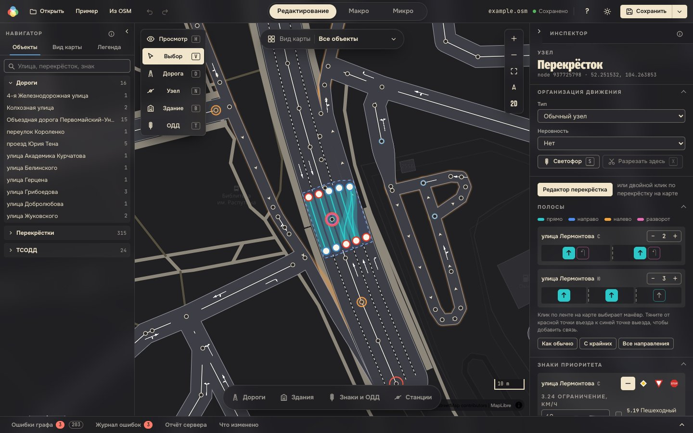
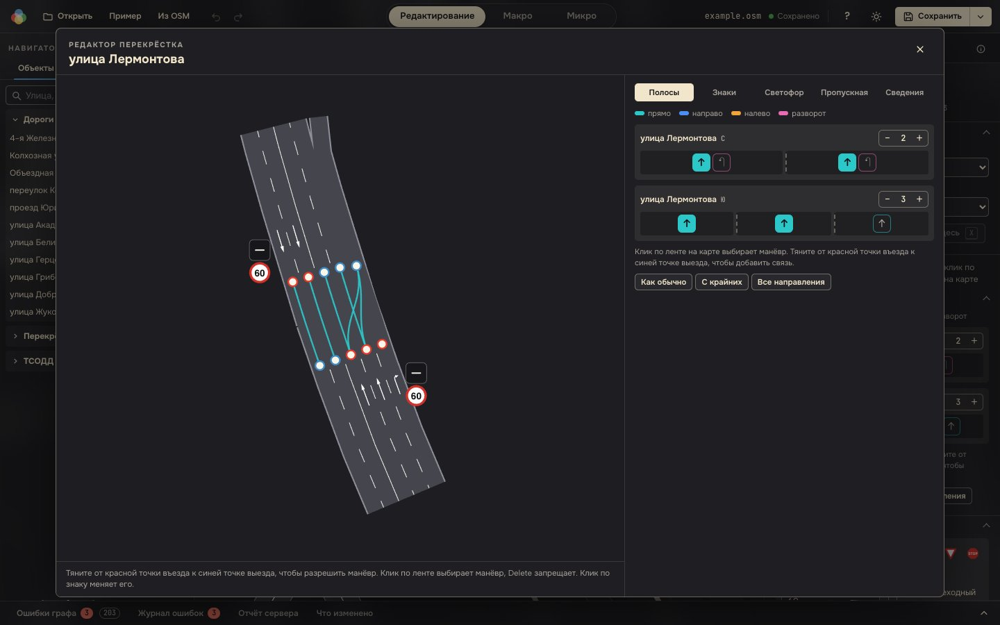
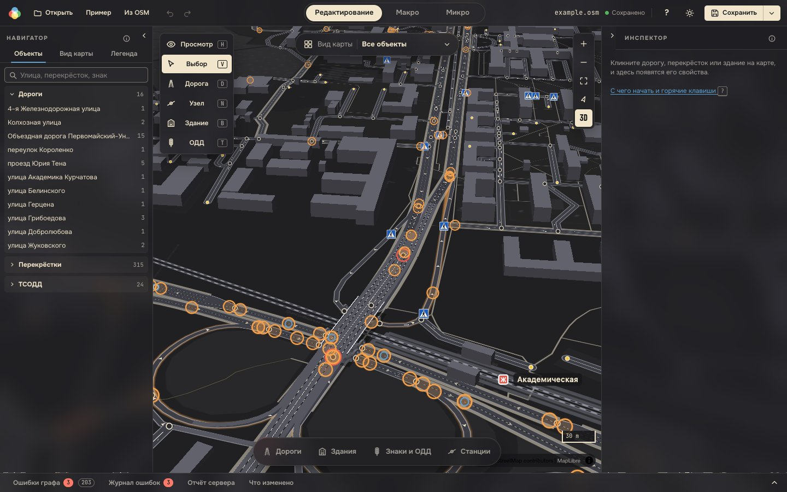
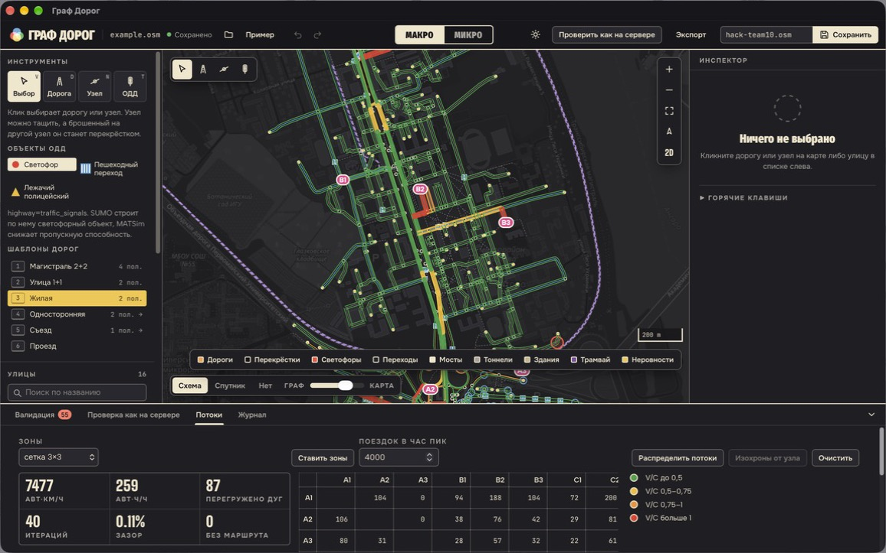
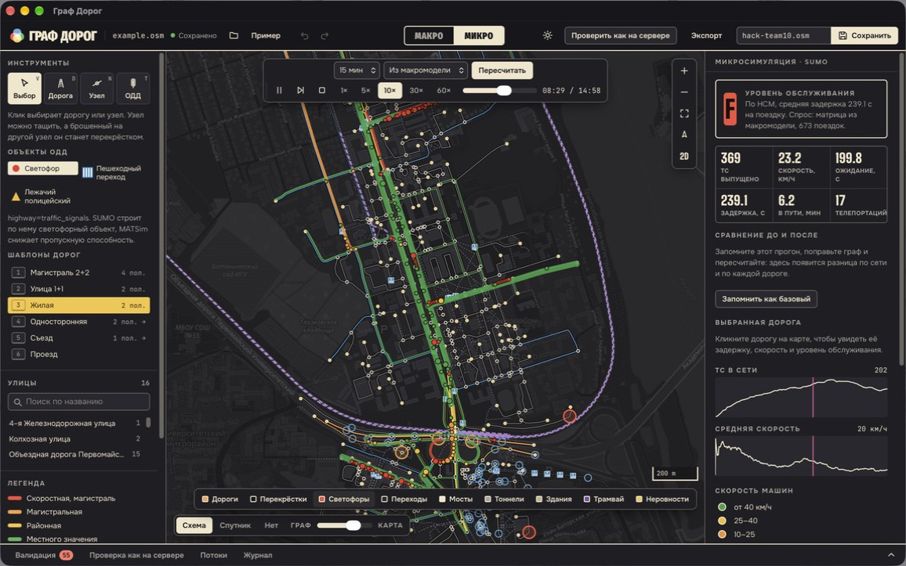
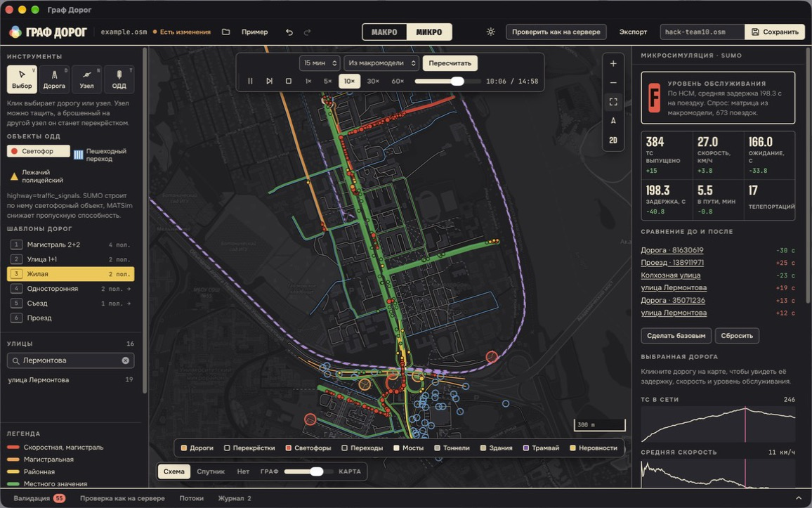
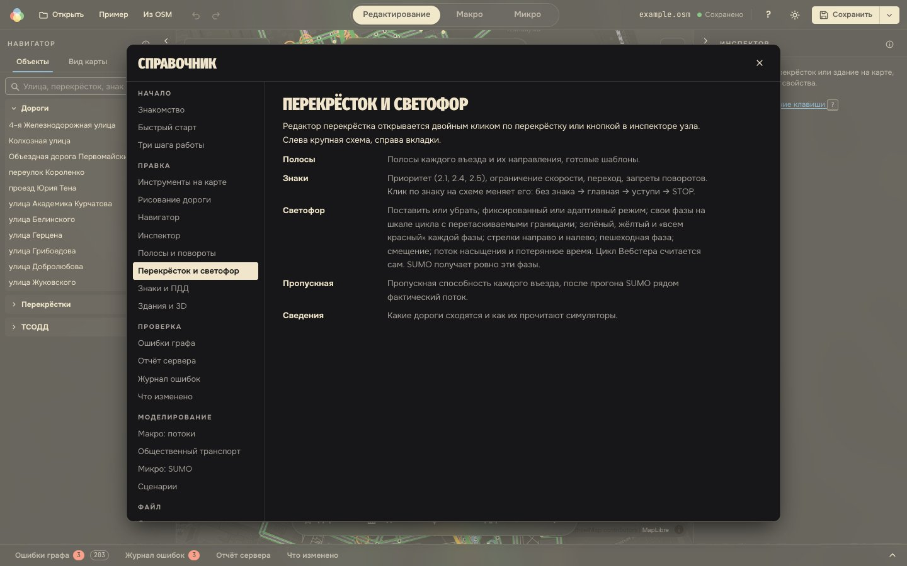

# Граф дорог

Настольный редактор улично-дорожной сети из OpenStreetMap для транспортных инженеров. Правьте дороги, полосы, перекрёстки, светофоры, знаки и здания. Тут же смотрите, как меняется движение: в час пик (макромодель) и по каждой машине (SUMO). Сохраняйте файл, который без ошибок примут MATSim, SUMO и Webots.

Команда **hack-team10**, хакатон «Транспортное планирование городов», Иркутск, 2026.
Итоговый граф для сдачи: [`submission/hack-team10.osm`](submission/hack-team10.osm).



| Редактор перекрёстка | 3D: здания, мосты, срез над дорогой |
|---|---|
|  |  |
| **Макро: загрузка дорог в час пик** | **Микро: SUMO, уровень обслуживания** |
|  |  |
| **Сравнение до и после правки** | **Встроенный справочник** |
|  |  |

## Что можно сделать

Всё это есть во встроенном справочнике (кнопка `?`). При первом запуске он открывается сам и проводит по приложению за четыре страницы.

### Открыть сеть

- **Свой файл** `.osm` (⌘O) или **пример из задания** одной кнопкой.
- **Любой район или город** прямо из OpenStreetMap: по названию, по видимой области карты или из готового списка. Иркутск целиком (627 км², около 100 тыс. узлов) скачивается примерно за минуту.
- **Недавние файлы** на стартовом экране. **Черновик** каждые 30 секунд: после сбоя правки восстанавливаются.

### Править дороги

- **Нарисовать дорогу** по точкам: магнит к узлам и дорогам, шаг угла 15°, прямые и плавные кривые, скругление углов по классу дороги. Шаблоны дорог по СП: класс, полосы, скорость, поперечный профиль.
- **Дорога через дом:** программа спросит, снести здание, срезать его по дороге или пустить дорогу поверх.
- **Клик выбирает участок** между перекрёстками, его правка не задевает соседей. Одной ссылкой выбирается вся линия или вся улица: полосы, скорость, класс и покрытие меняются на всех участках сразу.
- **Все параметры дороги:** класс, название, скорость, полосы туда и обратно, направления каждой полосы, полоса для автобусов, ширина проезжей части, минимальная скорость и скорость грузовых, доступ машинам и грузовым, масса и высота, обгон, освещение, велодорожка, парковка, кольцевое движение, тротуары по сторонам, мост, тоннель и уровень.
- **Профиль по СП 42.13330 и 34.13330:** категория, ширина полосы, расчётная скорость, пропускная способность и кнопка «Привести к норме».
- **«Как прочитают симуляторы»:** скорость, полосы и пропускная способность, как их увидят MATSim, SUMO и Webots.
- **Несколько дорог сразу:** Shift + рамка, общие поля задаются всем. Две дороги, сходящиеся концами, объединяются в одну.
- **Узлы:** вставить, перетащить, слить в перекрёсток, отсоединить дорогу, разрезать, задать координаты с точностью до сантиметра, двигать стрелками на 1 или 10 м.
- **Все теги OSM** у любого объекта: добавить, поменять, удалить. В файл попадают только стандартные теги.

### Настроить перекрёсток

- **Полосы на перекрёстке:** красные точки въезда тянутся к синим точкам выезда, связь задаёт манёвр. Повороты пишутся в `turn:lanes` и доходят до SUMO.
- **Знаки приоритета** кликом по схеме: раскрывается капсула выбора — без знака, главная, уступи дорогу, STOP. Запреты поворотов, ограничение скорости, переходы.
- **Светофор в деталях:** свои фазы на шкале цикла с перетаскиваемыми границами; зелёный, жёлтый и «всем красный»; стрелки направо и налево, пешеходная фаза, смещение, поток насыщения, цикл Вебстера. SUMO получает ровно эти фазы.
- **Пропускная способность** каждого въезда и список узких мест.

### Знаки и ПДД

- Знаки ПДД из каталога ставятся у края дороги со стороны курсора: приоритет, запрещающие, предписывающие, особых предписаний, переходы, неровности, остановки.
- **ПДД автоматически:** после каждой правки затронутые перекрёстки и дороги получают знаки приоритета, скорости, одностороннего движения, жилой зоны и переходы. Знаки, поставленные вручную, не трогаются. Одна кнопка приводит к ПДД весь граф.

### Здания и 3D

- Три шаблона зданий, которые сами встают вдоль дороги; форма правится ручками: углы, стороны, Г- и П-формы. Размеры, поворот, этажность, высота и крыша — числами.
- 3D (клавиша P): здания по высоте, мосты с настилом, бортиками и опорами, тоннели. Здание, закрывающее дорогу, срезается, чтобы дорогу было видно.

### Парковки

- Инструмент «Парковка» (клавиша K) или вкладка «Парковки» в капсуле внизу карты: площадка во дворе, стоянка или парковка у ТЦ сама встаёт вдоль ближней дороги, форма правится теми же ручками, что у здания.
- В инспекторе: вид (открытая, карман у дороги, многоуровневая, подземная, на крыше), оплата, кому можно, покрытие, сколько можно стоять, перехватывающая. Места считаются по площади, 25 м² на машину по СП 42.13330.2016, места для инвалидов — не меньше 10 % по СП 59.13330.2020.
- Всё пишется стандартными тегами `amenity=parking`: SUMO и MATSim их пропускают, Webots строит площадку, а многоуровневый паркинг — зданием. Все парковки файла с числом мест — в навигаторе.

### Проверить, что граф примут

- **Ошибки графа** находятся при каждой правке: изолированные участки, тупики по направлению, пересечения без общего узла, почти совпадающие узлы, дороги, обрезанные краем фрагмента, встречные потоки в лоб, дороги под зданиями, значения, на которых падает Webots. Ошибки и замечания считаются отдельно. Каждое чинится своей кнопкой, а «Исправить всё» применяет все исправления одним шагом: на примере из задания 206 замечаний превращаются в 13.
- **Проверка как на сервере:** граф проходит через те же netconvert и SUMO, MATSim и импортёр Webots, что у организаторов. Зелёный отчёт значит, что файл примут.
- **Журнал ошибок** сессии и **«Что изменено»** по сравнению с открытым файлом: с возвратом к любому шагу и выгрузкой.

### Посмотреть на движение

- **Макро:** зоны сеткой или вручную, гравитационная модель с целями «дом–работа» и «дом–прочее», равновесное распределение. Цвет дорог показывает загрузку V/C. Есть подбор β под среднюю поездку, изохроны, «кто едет по этой дороге», правка матрицы руками.
- **Микро:** SUMO пускает смешанный поток, автобусы по маршрутам и пешеходов. Видны очереди, задержка, уровень обслуживания A–F, тепловая карта задержек и узкие места.
- **Тонкая настройка моделей.** Микро: машин и пешеходов в час, доля транзита, seed, модель следования (Krauss, IDM, EIDM, Wiedemann 99), несовершенство водителя, интервал, скорость относительно лимита, состав потока по типам ТС, шаг модели. Макро: параметры BPR, итерации и точность равновесия, доля поездок на работу. Пустое поле — значение по умолчанию.
- **Сценарии:** база и правка рядом, сравнение пробега, задержки и скорости в одной таблице.

### Сохранить и отдать

- «Сохранить» (⌘S) пишет `.osm`. В меню рядом: имя файла для сервера (`hack-teamNN.osm`), «Сохранить как», сеть SUMO `.net.xml`, сеть MATSim `network.xml`, отчёт HTML с картой и графиками.

### Удобство

- Правый клик по объекту — меню действий с ним. ⌘F — поиск улицы, перекрёстка или знака. Горячие клавиши работают и в русской раскладке.
- Режимы вида карты (авто, пешеходы, общественный транспорт, железная дорога): в каждом видны и правятся только свои объекты.
- Подложка «Схема» или «Спутник», светлая и тёмная тема, панели тянутся и сворачиваются.
- Значки (i) на панелях: при наведении — коротко, по клику — нужный раздел справочника.

## Как запустить

Нужны Node.js 22 и npm, для настольного приложения — ещё Rust.

```bash
npm ci
npm run app      # настольное приложение
npm run dev      # веб-версия на http://localhost:5173, без SUMO, MATSim и Webots
```

Для проверки как на сервере и Микро на компьютере должны стоять SUMO, Java и MATSim, для 3D-проверки — Webots. Если SUMO не найден, приложение покажет команды установки; отчёт проверки называет программу, которой не хватает. Готовые сборки для macOS и Windows собирает GitHub Actions.

## Под капотом

Настольное приложение на Tauri 2 (Rust) с интерфейсом на React и TypeScript; карта и свой 3D-слой — на MapLibre GL и WebGL. Rust-часть запускает netconvert, SUMO, MATSim и импортёр Webots. Проверка графа и макромодель считаются в фоновых потоках, поэтому карта не тормозит. Больше 350 автотестов на TypeScript и Rust.

Подробно — в [docs/TECHNICAL.md](docs/TECHNICAL.md): сборка, проверка как на сервере, устройство интерфейса и назначение каждого файла. Ещё в `docs/`: [фичи и зачем они](docs/features.md), [правки графа](docs/changes.md), [воспроизводимость](docs/reproducibility.md), [стек](docs/STACK.md).
